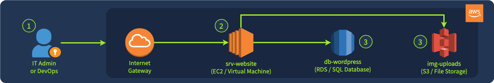

## Day 121
### [**Streak**](https://tryhackme.com/Tushig3531/streak)
---
**Room Completed**
[**AWS Security Logging**](https://tryhackme.com/room/awssecuritylogging)

---

> Today, I am learning AWS Cloud Security.

### Core AWS Services

- **Amazon EC2 (Elastic Compute Cloud)** : a computing service that provides resizeable, secure compute capacity as virtual servers
- **Amazon RDS (Relational Database Service)**
- **Amazon S3 (Simple Storage Service)**

### What We Monitor

- **Control Plane** : monitor the actions of those who access the AWS console and manage the infrastructure
- **Workloads** : monitor files and processes on the website's VM, same as we would do on premises
- **Managed Services** : monitor access to the RDS database and suspicious changes to the S3 file storage



**Control Plane Chaos** : IT teams manage AWS resources via a graphical interface, while others use automation tools such as Terraform.
- Terraform is an infrastructure as code tool that lets you build, change, and version infrastructure safely and efficiently

**Containerized Workload** : IT can run its applications in managed containers (Amazon Fargate) or use other serverless technologies.
- AWS Fargate is a serverless, pay as you go compute engine that lets you focus on building applications without managing servers

**Too Many Managed Services** : AWS has more than 200 managed services, many of which can be exploited in cyber attacks. The service selection made by our company defines which logs the SOC must ingest and which detection rules we must prepare.

### Covering AWS Control Plane

**CloudTrail** is the first AWS service any SOC analyst must know.
- Records all control plane activities, including console logins, launching EC2 instances, access to S3 buckets, changes in user privileges and network settings, and more
- CloudTrail logs all API calls

**Log Format Example** (ConsoleLogin event, simplified):

```bash
{
  "eventID": "b12da7f9-36a9-4ac1-9cb6-7d3b4874d2a7",
  "eventTime": "2025-12-10T17:54:44Z",
  "eventSource": "signin.amazonaws.com",
  "eventName": "ConsoleLogin",
  "awsRegion": "us-east-1",
  "sourceIPAddress": "72.44.21.87",
  "userAgent": "Mozilla/5.0 [...]",
  "requestParameters": null,
  "responseElements": {
    "ConsoleLogin": "Success"
  },
  "readOnly": false,
  "recipientAccountId": "398985017225",
   "userIdentity": {
    "type": "IAMUser",
    "arn": "arn:aws:iam::398985017225:user/john.doe",
    "accountId": "398985017225",
    "userName": "john.doe"
  },
}
```

| Field | Meaning |
|---|---|
| eventSource | AWS service that was requested |
| eventName | The name of the API call |
| recipientAccountId | The target AWS account of the API call |
| requestParameters | Event specific details. For CreateBucket, it would contain the name of the created S3 bucket |
| userIdentity.* | Details about the actor behind the API call |
| readOnly | Whether the API call is a read (e.g. GetObject) or a non-read request (e.g. PutObject, ConsoleLogin) |

### CloudTrail and GuardDuty

CloudTrail gives us the visibility needed to detect incidents by recording every API call.

Example: SSH access to our Linux VM suddenly becomes public, and we need to know who changed the firewall rules. Search CloudTrail for `ModifySecurityGroupRules` events and review the matching record:

```bash
// Insecure security group modification (simplified)
{
  "eventTime": "2025-12-12T15:19:57Z",
  "eventSource": "ec2.amazonaws.com",
  "eventName": "ModifySecurityGroupRules",                    // Change in AWS security group (VM firewall)
  "awsRegion": "us-east-1",
  "sourceIPAddress": "34.77.14.56",
  "userAgent": "Mozilla/5.0 [...]",
  "requestParameters": {
    "ModifySecurityGroupRulesRequest": {
      "SecurityGroupRule": {
        "SecurityGroupRuleId": "sgr-0134d56a1ff2c9c74",
        "SecurityGroupRule": {                                // The actual change to the security group
          "CidrIpv4": "0.0.0.0/0",                            // Allows access from anywhere on the Internet
          "FromPort": 22,                                     // To ports in range 22-22 (just one SSH port)
          "ToPort": 22,
          "IpProtocol": "tcp"
        }
      },
      "GroupId": "sg-023caa3bf78723abe"                       // The security group can be used by many VMs
    }
  },
  "responseElements": {...},
  "readOnly": false,                                          // Indicates a "write", risky API call
  "recipientAccountId": "398985017225",
  "userIdentity": {
    "type": "IAMUser",
    "arn": "arn:aws:iam::398985017225:user/jeff.harrison",
    "accountId": "398985017225",
    "userName": "jeff.harrison"                               // Now you know who exposed the SSH port
  },
}
```

**GuardDuty**

GuardDuty is an AWS service that automatically analyzes control plane, network, DNS, and endpoint activities within AWS and generates alerts on suspicious behavior in real time.
- Ready to use out of the box, with many built in detection rules (finding types) covering the most common AWS threats

Example log:

```bash
{
  "AccountId": "398985017225",
  "CreatedAt": "2025-12-12T16:57:03.190Z",
  "Id": "c4cd89bf4deb284b5d317d22180ac495",
  "Resource": {                                 // Affected resource details, if any
      "InstanceDetails": {
      "ImageId": "ami-0ecb62995f68bb549",
      "InstanceId": "i-04fa0268276e1f763",
      "InstanceType": "t3.micro",
      "LaunchTime": "2025-12-12T15:17:18.000Z",
      "NetworkInterfaces": [...],
      "Tags": [...]
    },
    "ResourceType": "Instance"
  },
  "Service": {                                  // Finding-specific alert details
  "Action": {
      "ActionType": "NETWORK_CONNECTION",
      "NetworkConnectionAction": {
        "RemoteIpDetails": { "IpAddressV4": "45.32.185.122" },
        "RemotePortDetails": { "Port": 3333 }
      }
    },
    "FeatureName": "VpcFlowLogs",               // Log source used to detect the threat
    "ResourceRole": "TARGET",
    "ServiceName": "guardduty"
  },
  "Severity": 8,                                // Alert severity ranging from 1 to 10
  "Title": "The EC2 instance is [...]",         // The title you saw on the screenshot
  "Type": "CryptoCurrency:EC2/BitcoinTool.B",   // Detection rule (finding type) ID
  "UpdatedAt": "2025-12-12T16:57:03.190Z"
}
```

**GuardDuty limitations:**
- Alerts often lack sufficient context to fully scope and document the attack
- Detection rules do not adapt to our company specific policies and risks
- Effective against common threats, but unlikely to detect advanced attacks
- Can't reliably detect when AWS logging itself is tampered with or disabled

### Covering Managed Services

CloudTrail is ideal for capturing control plane operations, but it doesn't provide visibility into service specific actions. For example, it can't see queries made to an Amazon RDS database, network traffic flowing through our VPCs, web requests served through Amazon CloudFront, and many other operations.

**CloudFront** is a CDN service heavily used by AWS customers to optimize and secure web applications.
- Comparable to Cloudflare, Fastly, and Akamai
- Important because it usually routes all web traffic, so it can capture SQL injections, CVE exploits, web shell uploads, brute force, and DDoS attacks

Example log:

```bash
date       time     edge_srv sc_bytes c_ip         cs_method cs_host       cs_uri_stem sc_status cs_user_agent
2025-12-12 11:32:11 SFO53-C1 4955     80.42.89.4   POST      tryhackme.com /login      200       Mozilla/5.0   [...]
2025-12-12 11:32:24 SFO53-C1 6002     88.15.14.16  GET       tryhackme.com /portal     200       Mozilla/5.0   [...]
2025-12-12 11:32:35 SFO53-C1 1624     13.13.17.146 GET       tryhackme.com /search     200       Mozilla/5.0   [...]
```

**VPC Flow Logs**

Records network flows to, from, and between our cloud workloads, giving us visibility into how systems communicate across our subnets.

Example log:

```bash
version account-id interface-id srcaddr       dstaddr      srcport dstport protocol action [...]
2       123456789  eni-12345678 172.31.16.4   172.31.16.7  20641   80      6        ACCEPT [...]
2       123456789  eni-12345678 172.31.9.69   172.31.9.12  49761   22      6        REJECT [...]
```

### Logging of AWS Workloads

When a company doesn't use AWS managed services, the SOC has to do more of the monitoring work itself.

**Managed vs. unmanaged**

A managed service like Amazon S3 or Aurora is run by AWS. AWS handles the server, the OS, and the patches, and gives us logs through its APIs (CloudTrail, for example). We just collect them.

Some companies run their own software on EC2 instead, because of cost, regulations, or niche needs. Examples: PostgreSQL on an EC2 instance instead of Aurora, or Nginx instead of an AWS load balancer. In that case AWS only gives us the virtual machine, and everything inside it is our responsibility.

**What that means for a SOC analyst**

We go back to normal endpoint monitoring, like an office network:
- Install a SIEM agent on each VM (like a Splunk Universal Forwarder)
- Run Sysmon (Windows) or Auditd (Linux) to log process and file activity
- Track software vulnerabilities, since nobody else is patching them

An EC2 instance is basically just a server that lives in someone else's data center.

**Containers and serverless**

As companies grow, they often move to containers (ECS, Kubernetes) or serverless (Lambda). Our usual tools don't work well there:
- **Containers** : Auditd and most EDR tools struggle. Use container tools like Falco, or a cloud security platform (CWPP) like Wiz
- **Serverless** : there's no machine to put an agent on, so we rely on CWPP tools or AWS's security guidance for that service

Takeaway: we can't secure the cloud well without knowing Linux, containers, and Kubernetes.

---

<!--  -->