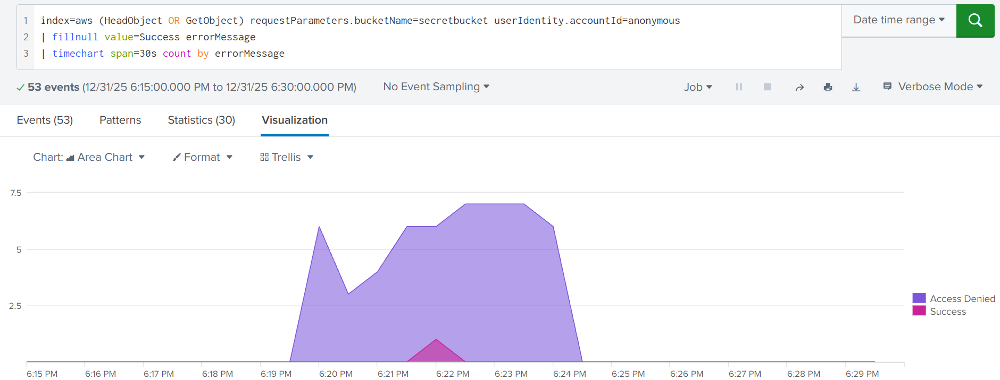
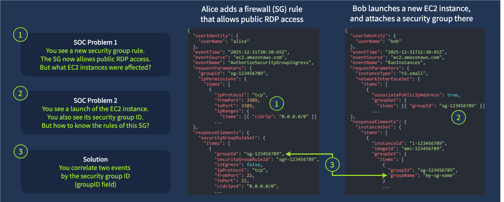
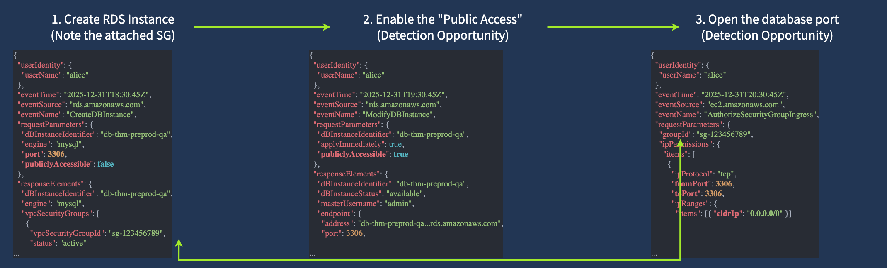
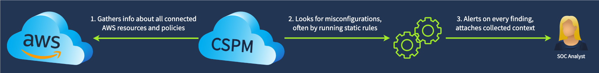
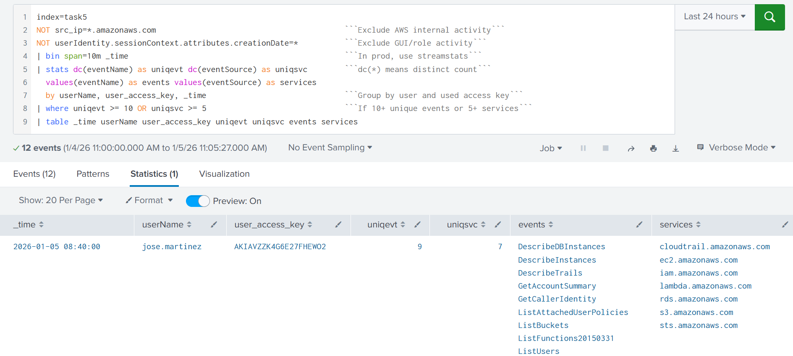

## Day 123
### [**Streak**](https://tryhackme.com/Tushig3531/streak)
---
**Room Completed**
[**Monitoring AWS Services**](https://tryhackme.com/room/monitoringawsservices)

---

> Today, I am learning AWS Cloud Security.

### S3 Attacks and Defenses

**Early Detection**

New buckets are private by default. To make one public, someone has to do two steps:
- Turn off the safety switch: `PutBucketPublicAccessBlock`
- Open access: `PutBucketPolicy` (or `PutBucketAcl`, the older way)

So alert on both.

**How to read a bucket policy, look for:**
- `Effect: "Allow"` and `Principal: "*"` : means anyone can access
- `Action` : what they can do. `GetObject` = read files, `ListBucket` = see file names, `PutObject` = upload
- `Condition` : limits that may make it safe

Example log:

```bash
// Key field from the PutBucketPolicy event
{
  "eventTime": "2025-12-31T17:55:15Z",
  "eventSource": "s3.amazonaws.com",
  "eventName": "PutBucketPolicy",
  "userIdentity": {
    "userName": "alex.morgan",
  },
  "requestParameters": {
    "bucketName": "thm-internal-backups",
    "bucketPolicy": {                                          // Here starts the applied policy
      "Version": "2012-10-17",
      "Statement": [
        {
          "Sid": "AllowAccessOnlyFromTorontoOffice",           // Sid is optional, but can be helpful
          "Effect": "Allow",                                   // Note that it can also be set to Deny
          "Principal": "*",                                    // Allow public, anonymous bucket access
          "Action": "s3:GetObject",                            // Allow public read, not list or write
          "Resource": "arn:aws:s3:::thm-internal-backups/*",
          "Condition": {                                       // Investigate the Condition field (if any)
            "IpAddress": {                                     // Allow access only from the specified IP
              "aws:SourceIp": [ "67.55.61.83/32" ]
            }
        [...]
}
```

**Not every public bucket is bad.** Some buckets need public read, like user avatars or website images. To check:
- Look at the bucket name and tags
- Open a file in the browser: `https://BUCKET.s3.amazonaws.com/FILE`
- If unsure, ask IT or the bucket owner

**Late Detection**

Catch outsiders accessing the bucket. If we missed the bucket going public, bots will find it. Watch for:
- `GetObject` or `HeadObject` from anonymous users and outside IPs
- Lots of "Access Denied" errors. If listing is blocked, attackers guess file names, which creates a spike of failures



**GuardDuty**

Writing rules that handle every policy condition is hard. Amazon GuardDuty does it automatically.

| Finding | Meaning |
|---|---|
| `Policy:S3/BucketBlockPublicAccessDisabled` | The public access safety switch was turned off |
| `Policy:S3/BucketAnonymousAccessGranted` | The bucket was made public |
| `Impact:S3/MaliciousIPCaller` | A known bad IP accessed the bucket |

### EC2 Internet Exposure

**Security groups (SG)**

A security group is a firewall for EC2. It decides which ports are open and to whom.

**The common breach**

Someone opens a port (SSH, RDP) to the internet, then protects it badly: weak password, leaked SSH key, or a vulnerable web app. Attackers get in.

**Early detection**


- Alice changes an SG to allow RDP from 0.0.0.0/0
- Bob launches an EC2 server using that SG

**Hunt 1: A new security group has been created**

| Step | What to do | Query |
|---|---|---|
| 1 | Find the new SG and note its name and ID | `index=* eventName=CreateSecurityGroup` |
| 2 | Check its inbound rules for anything risky | `index=* eventName=AuthorizeSecurityGroupIngress sg-xxxxxx` |
| 3 | See which servers use it | `index=* eventName IN (RunInstances, ModifyInstanceAttribute) sg-xxxxxx` |
| 4 | If risky, ask the creator to fix it | |

**Hunt 2: One of the security group rules has been modified**

| Step | What to do | Query |
|---|---|---|
| 1 | Find the change and note the SG ID | `index=* eventName IN (*SecurityGroupIngress, ModifySecurityGroupRules)` |
| 2 | Find who created the SG and why (search back a year) | `index=* earliest=-1y eventName=CreateSecurityGroup sg-xxxxxx` |
| 3 | See which servers use it (RDS uses SGs too) | `index=* eventName IN (RunInstances, ModifyInstanceAttribute) sg-xxxxxx` |
| 4 | If risky, ask the person to fix it | |

**Double check before raising an incident.** AWS has other traffic controls too (network ACLs, the VM's own firewall). A server can look open in the logs but actually be blocked.

**Late Detection**

If we missed the SG change, attackers (like a crypto miner hitting open SSH) will find the server. Catch it in layers:
- CloudTrail : alert on risky SG changes (above)
- GuardDuty : `Recon:EC2/PortProbeUnprotectedPort` means someone is scanning an open port
- `auth.log` on the VM : detect SSH brute force
- Last resort : EDR, network, or endpoint logs catch the miner after it lands

### Risk of Public Databases

**Which databases can be exposed**

RDS, DynamoDB, Redshift, and OpenSearch can all be made public. There's no single playbook, because each service handles "public" differently. But most use one or both of:
- Access policies : who's allowed in (like S3 bucket policies)
- Network controls : VPCs, subnets, ACLs, and security groups (like EC2)

**RDS example**

RDS is where companies usually keep emails, passwords, and credit cards. To expose it, two things must happen:
- Turn on the "Public Access" switch
- Allow 0.0.0.0/0 in the database's security group



| Event | What it means |
|---|---|
| `CreateDBInstance` | New database. Public Access can be turned on right at creation |
| `ModifyDBInstance` | Settings changed. Public Access may have been turned on later |
| `*SecurityGroupIngress`, `ModifySecurityGroupRules` | The DB's security group was opened up |

A database can be private for years, then become public from one bad change.

**CSPM: let a tool do it**

Catching every exposure by hand is hard, too many edge cases. For daily SOC work, teams use CSPM (Cloud Security Posture Management) tools like AWS Config, Wiz, or Lacework. They:
- Constantly scan AWS for misconfigurations
- Flag anything exposed, vulnerable, or misconfigured
- Can auto fix it without waiting for the SOC
- Give alerts with more context than raw CloudTrail logs



### Detecting Cloud Discovery

**Why discovery happens**

Sometimes attackers can't cause damage right away (not enough permissions, good security). So first they look around and map the account to find the best next step.

**Initial Discovery: "Who am I?"**

Just like `whoami` on Linux or Windows. In the console this is hard to spot, because the website makes these calls automatically.

| Command | Event | What the attacker learns |
|---|---|---|
| `aws sts get-caller-identity` | `GetCallerIdentity` | Who am I? (AWS's whoami) |
| `aws iam list-attached-user-policies` | `ListAttachedUserPolicies` | What permissions do I have? |
| `aws iam get-account-summary` | `GetAccountSummary` | How big is this account? Users, policies, MFA |

```bash
// GetCallerIdentity: AWS alternative for "whoami"
attacker@kali:~$ aws iam get-caller-identity
{
    "UserId": "AIDAVZZK4G6EVLTNRWXXX",
    "Account": "398985017225",
    "Arn": "arn:aws:iam::398985017225:user/john.doe"
}
// ListAttachedUserPolicies: Verifying own privileges
attacker@kali:~$ aws iam list-attached-user-policies --user-name john.doe
[{
    "PolicyName": "AdministratorAccess",
    "PolicyArn": "arn:aws:iam::aws:policy/AdministratorAccess"
}]
// GetAccountSummary: Listing AWS account statistics
attacker@kali:~$ aws iam get-account-summary
{
    "Policies": 12,
    "Users": 16,
    "Providers": 1,
    "AccountMFAEnabled": 4,
    "AccountAccessKeysPresent": 1,
    "AccountPasswordPresent": 1,
    [...]
}
```

**Broad Discovery: scan everything**

| Event | What they're looking for |
|---|---|
| `ListBuckets` | S3 buckets |
| `DescribeInstances` | EC2 servers |
| `ListFunctions*` | Lambda functions |
| `ListUsers` | IAM users (especially admins) |



**Deeper Discovery: zoom in on a target**

Once they find something interesting, they dig deeper:
- Found a user with `ListUsers`, then run `GetUser` and `ListAccessKeys` on that user
- Search for valuable servers by name, like `*secret*` or `*vault*`

Example log for deep discovery:

```bash
{
  "userIdentity": {
    "userName": "john.doe"
  },
  "eventTime": "2025-12-31T10:30:45Z",
  "eventSource": "ec2.amazonaws.com",
  "eventName": "DescribeInstances",
  "awsRegion": "us-east-1",
  "sourceIPAddress": "167.99.40.20",                              // #1 Known-malicious IP!
  "userAgent": "aws-cli/1.22.34 Linux/5.15.0-kali3-amd64 [...]",  // #2 Kali Linux user-agent!
  "requestParameters": {
    "instancesSet": {},
    "filterSet": {
      "items": [                                                  // #3 Suspicious search keywords!
        {
          "name": "tag:Name",
          "valueSet": {
            "items": [{ "value": "*vault*" }, { "value": "*secret*" }]
...
}
```

### Denial of Wallet Attack

Denial of Wallet (DoW): attacks that don't take you offline, they just make your AWS bill huge.

**The idea**

Modern cloud defenses (autoscaling, CDNs, WAFs, serverless) make normal DoS hard. Our site stays up. The catch: we pay for everything. Every extra request, every new server, sometimes even every blocked request. So instead of crashing our site, attackers drain our money.

**What the SOC can do**

The SOC can detect and respond short term, but not fully fix it:
- Spot the spike in requests
- Block bad IPs (temporary fix)
- Report the risk to IT

**What to tell IT (general fix for any cloud):**
1. Validate if the resource under attack is expected to be public. It's possible it shouldn't have been public in the first place
2. Block exploits, known bad IPs, and user agents with a WAF. In most clouds, blocked requests are much cheaper than allowed ones
3. Cache server responses and rate limit user requests with a CDN. For example, cache images in S3 with CloudFront CDN
4. Finally, optimize the compute work (CPU, RAM, network usage). The faster the app is, the lower the amount paid for compute services

---

<!--  -->