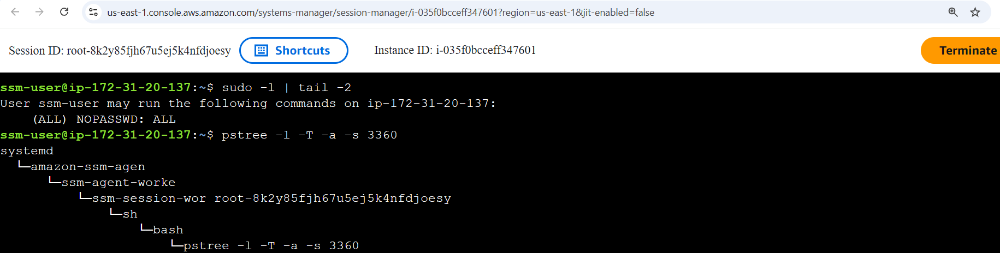
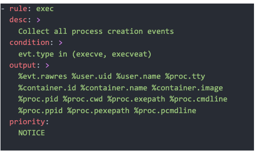
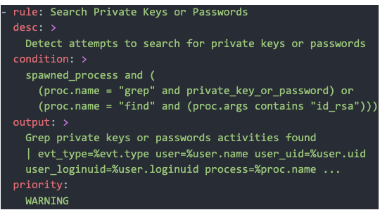
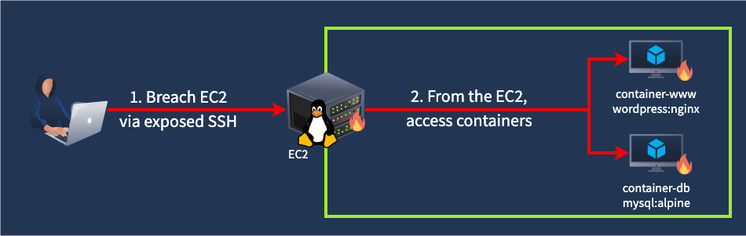
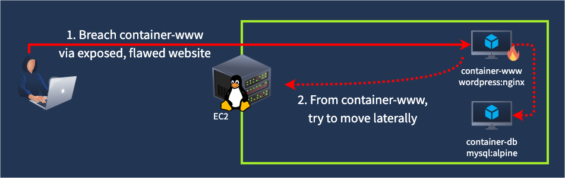
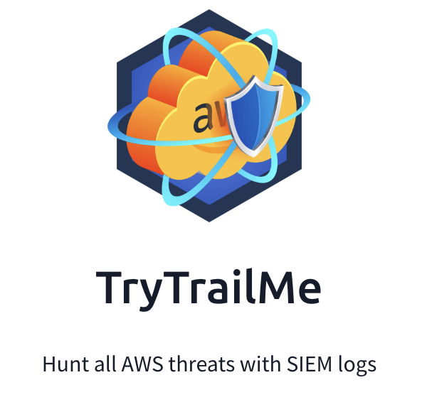

## Day 124
### [**Streak**](https://tryhackme.com/Tushig3531/streak)
---
**Room Completed**
[**Monitoring AWS Workloads**](https://tryhackme.com/room/monitoringawsworkloads)

---

> Today, I am learning AWS Cloud Security.

## Monitoring EC2

This part covers three AWS services that work with EC2, and why they make monitoring harder.

### AWS Systems Manager

SSM lets admins manage many EC2 servers at once: install software, update the OS, run scripts. It needs an SSM agent installed on each server. The agent connects to AWS and waits for commands.

**How it works:**
- Admin picks a script and target servers
- CloudTrail logs it as `SendCommand`
- Results show in the SSM console

The danger: if an attacker gets in, SSM becomes a ready made C2. They can push malware to every server with the agent in one click.

**How to investigate:**
- CloudTrail shows `SendCommand` but not the full script
- To see what ran, check the SSM console or endpoint logs (auditd)
- Look for this process tree:

```bash
root@ec2-demo:~$ pstree -l -T -a -s 3810
systemd                                                    # OS itself, first process
└── amazon-ssm-agent                                       # SSM agent service (root)
    └── ssm-agent-worker                                   # Per-command worker process
        └── ssm-document-worker d47130a2-4f90-41af-...     # Same ID as in the SendCommand
            └── sh -c /var/lib/amazon/ssm/.../_script.sh
                └── sh /var/lib/amazon/ssm/.../_script.sh
                    ├── echo "My command!"                 # The first script command
                    └── sleep 100                          # The second script command
```

### AWS Session Manager

Lets us open a terminal on EC2 from the AWS website. It uses the SSM agent, so no SSH or RDP port needs to be open.

**Monitoring differences:**
- CloudTrail : each connection is a `StartSession` event
- `auth.log` : shows nothing useful, since it's not SSH. The connection tunnels through the SSM agent
- To tell SSH from SSM: check the process tree. If we see ssm processes above the shell, it came through Session Manager



### EC2 Auto Scaling

Automatically adds servers when busy, removes them when quiet.

**SOC problems:**

| Problem | Why |
|---|---|
| EDR limits | EDR often needs a reboot or time to learn. A server living 10 to 15 minutes gets little protection |
| Asset tracking | Hard to keep a list of servers. We need a script to auto install SIEM/EDR agents on every new one |
| Lost evidence | When a server shuts down, its forensic evidence is gone. Saving it needs complex automation |

Still worth protecting: an attacker can exploit a bug on a random worker. If it shuts down, they just exploit the next one, again and again.

**Splunk Queries**

SSM commands:
```bash
index=aws eventName=SendCommand
```

Session Manager logins:
```bash
index=aws eventName=StartSession
```

## Falco for EC2

This part introduces Falco, a newer tool that replaces Auditd for monitoring what happens inside EC2 servers and containers.

**Why not just Auditd?**

Auditd works, but:
- Its logs are hard to read
- It's missing context (like the parent process)
- That makes good detection rules and exclusions hard to write

**What a Falco log looks like:**

```bash
root@ec2-demo:~$ grep whoami /var/log/falco.json | jq  // Can log in plaintext and JSON
{
  "hostname": "ec2-demo",
  "output_fields": {
    "container.id": "425f43aad5c9",                    // Includes Docker container context
    "container.image": "wordpress:php8.2-apache",
    "container.name": "mywebsite",
    "proc.cmdline": "whoami",                          // Conveniently logs process fields
    "proc.cwd": "/root/",
    "proc.exepath": "/usr/bin/whoami",
    "proc.pcmdline": "bash",                           // Unlike Auditd, includes parent info
    "proc.pexepath": "/usr/bin/bash",
    "proc.pid": 6997,
    "proc.ppid": 6988,
    "proc.tty": 34816,                                 // TTY is similar to Windows Logon ID
    "user.name": "root",
  },
  "priority": "Notice",                                // Supports filtering and customization
  "rule": "exec",
  "source": "syscall"
}
```

For someone running `whoami`, Falco shows:

| Field | Meaning |
|---|---|
| `proc.cmdline` | The command: `whoami` |
| `proc.pcmdline` / `proc.pexepath` | Parent process: `bash` (Auditd doesn't give this easily) |
| `user.name` | Who ran it: `root` |
| `proc.tty` | Session ID, like a Windows Logon ID |
| `container.name` / `container.image` | Which Docker container it ran in |
| `priority` | Severity, for filtering |

It can log as plain text or JSON, which is SIEM friendly.

**What Falco is**

An open source runtime detection engine for Linux. It uses rules, and the rules decide its role:
- Low level rules : log raw events, like every process launch (Auditd style)
- High level rules : fire real alerts, like "someone used grep to search for passwords" (SIEM style), then send them to our SIEM

| Low level, Auditd style Falco rule | High level, SIEM style Falco rule |
|---|---|
|  |  |

**Example Splunk query:**
```bash
index=task3
| rename output_fields.* as *
| rename proc.tty as logon.session, evt.rawres as exit.code
| table _time user.name logon.session proc.pid proc.cmdline proc.ppid proc.pexepath exit.code
```

This gives a clean table: who ran what, in which session, from which parent, and whether it worked.

**Where Falco beats other tools:**

| Situation | Problem with old tools | Falco fix |
|---|---|---|
| 1,000 tiny EC2 servers | SIEM + EDR agents eat over 4 GB disk and 1 GB RAM, overloading small servers | Falco is lightweight and sends only key events |
| Short lived autoscaled servers | Auditd floods the SIEM with terabytes of identical, 99% useless logs | Run detection on the server, send only alerts. Much less data |
| Containers on EC2 | Sysmon for Linux can't see inside containers | Falco was built for containers and shows container context |

In short: Falco is like Auditd but cleaner, with parent process and container info, and it's light enough for small, short lived, and containerized cloud workloads.

## Monitoring Containers

**"Monitoring containers" means two layers.** Containers run on top of a host VM, so we watch both:

- **Host hacked** (like through open SSH) : all containers on it are at risk
- **One container hacked** (like a buggy website) : damage stays in that container, unless the attacker escapes to the host or another container




| Scenario | How it starts | What happens next |
|---|---|---|
| 1. Via host | Attacker gets into EC2 through open SSH | Reaches every container on it |
| 2. Via container | Attacker exploits a vulnerable website container | Tries to move to the host or other containers |

**Why each part is valuable to attackers:**
- EC2 host : crypto mining
- Website container : serving malicious ads
- Database container : stealing customer data

**Where to install monitoring: on the host**

Containers are sandboxed. Run `ps` inside one and we only see its own processes. Run `ps` on the host and we see everything.

Also, PIDs don't match:
- Inside the container, `sleep` is PID 69
- On the host, the same `sleep` is PID 63653

```bash
root@ec2-demo:~$ docker exec -it my-webserver /bin/sh      // Enter container terminal
/ # sleep 999                                              // Run "sleep" inside the container
/ # ps -eo pid,user,args                                   // Run "ps" inside the container
PID   USER     COMMAND                                     // Observe only container processes
   1 root     nginx: master process nginx;
   30 nginx    nginx: worker process
   31 nginx    nginx: worker process
   63 root     sh
   69 root     sleep 999                                   // The "container" PID of "sleep" (69)
/ # exit
root@ec2-demo:~# ps -eo pid,user,args                      // Run "ps", now from the host VM
    PID USER     COMMAND                                   // Note that PIDs do not match
      1 root     /usr/lib/systemd/systemd
  29319 syslog   /usr/sbin/rsyslogd -n -iNONE
  [ ... Skipping a hundred more processes ... ]
  63428 root     /usr/bin/containerd-shim-runc-v2
  63451 root     nginx: master process nginx;
  63495 systemd+ nginx: worker process
  63496 systemd+ nginx: worker process
  63653 root     sleep 999                                 // The "real" PID of "sleep" (63653)
```

So put the agent on the EC2 host to see all process, file, and network activity.

**AWS Fargate**

Fargate runs "serverless" containers: AWS manages the hosts, and we can't access them. That means:
- Host based SIEM and EDR agents stop working, since there's no host to install them on
- We need a tool that supports Fargate, like Falco, deployed as a sidecar (a helper container running next to our app)

In short: monitor both host and containers, install agents on the host, use a container aware tool to tell them apart, and remember Fargate removes the host entirely.

## Falco for Containers

How Falco tells us which container did something, and how to find it ourselves from the process tree.

**How Falco knows the container**

Falco reads Linux process info (namespaces and cgroups) to match each event to a container. Then it asks Docker for the container name and image and adds them to the log.

**Why that helps:**
- Quickly find which container was hacked
- Hunt inside one container only
- Build a normal baseline per container to spot anything unusual
- Write rules or exclusions for specific containers

**Reading a Falco example like an investigation:**

```bash 
root@ec2-demo:~$ tail /var/log/falco.json | jq
{
  "hostname": "ec2-demo",
  "output_fields": {
    // 1. Suspicious "find" command! Who launched it and why?
    "proc.cmdline": "sh -c find / -name *secret*",
    "proc.cwd": "/var/www/html/",
    "proc.exepath": "/usr/bin/sh",
    // 2. The parent process is Apache, does it mean a web shell?
    "proc.pcmdline": "apache2 -DFOREGROUND",
    "proc.pexepath": "/usr/bin/nginx",
    "proc.pid": 7924,
    "proc.ppid": 2285,
    "proc.tty": 0,
    "user.name": "www-data",
    // 3. The activity occurs on a THM production website!
    "container.name": "www-tryhatme-prod",
    // 4. The website uses WordPress, maybe it's vulnerable?
    "container.image": "wordpress:php8.2-apache",
    // 5. Investigate container files and web logs to find out!
    "container.id": "c1ac9c6d51d7",
  },
  "priority": "Notice",
  "rule": "exec",
  "source": "syscall"
}
```

| Step | Field | What it tells us |
|---|---|---|
| 1 | `proc.cmdline: find / -name *secret*` | Someone is hunting for secrets. Suspicious |
| 2 | `proc.pcmdline: apache2` | The web server launched it. Possible web shell |
| 3 | `user.name: www-data` | Running as the web server user, which fits a web exploit |
| 4 | `container.name: www-tryhatme-prod` | It's the production website |
| 5 | `container.image: wordpress:php8.2-apache` | WordPress, which often has vulnerable plugins |

**Two Falco modes for containers:**

| | Raw OS events | SIEM style alerts |
|---|---|---|
| Examples | `execve` (every process), `openat` (every file open) | "Wget from suspicious GitHub URL", "File written to /tmp" |
| Volume | Very high, every action logged | Low, only when a rule matches |
| Visibility | See everything | See only what our rules cover |

## AWS Lambda Theory

**What Lambda is**

Lambda runs small pieces of code without any server for us to manage. The code runs when an event happens, and we pay only for the time it runs.

Examples:
- Image uploaded to S3, Lambda resizes it, saves it to another bucket
- Backend for a web app, or "glue" between parts
- Auto respond to a GuardDuty finding (isolate or delete a resource)
- Create an EC2 lab when a Slack or Teams message arrives

**Lambda security depends on three things:**

| Part | What it controls |
|---|---|
| Code | What the function actually does (Python, Node.js, etc.) |
| Trust policy | Who can edit or trigger the function |
| Execution role | What the function is allowed to do in AWS (like reading S3) |

**How attackers abuse Lambda:**

| MITRE tactic | Example |
|---|---|
| Initial Access | Vulnerable code leaks AWS tokens or keys |
| Persistence | Attacker creates a hidden function that opens a backdoor under certain conditions |
| Privilege Escalation | If we can edit a function with AdministratorAccess, we basically are admin |
| Impact | Use functions to automate damage or run crypto miners |

**Monitoring in CloudTrail**

Start with all write events from Lambda:
```bash
index=aws eventSource=lambda.amazonaws.com readOnly=false
```

Everything left is worth checking.

**Key events to watch:**

| Event | Why it matters |
|---|---|
| `AddPermission*` | Changes who can trigger the function. `principal=*` means anyone can run it |
| `UpdateFunctionCode*`, `PublishLayerVersion*` | Code or libraries changed. Could hide a backdoor |
| `CreateFunction*`, `UpdateFunctionConfiguration*` | Check the execution role. Too much power (like AdministratorAccess) means alert IT |

---

